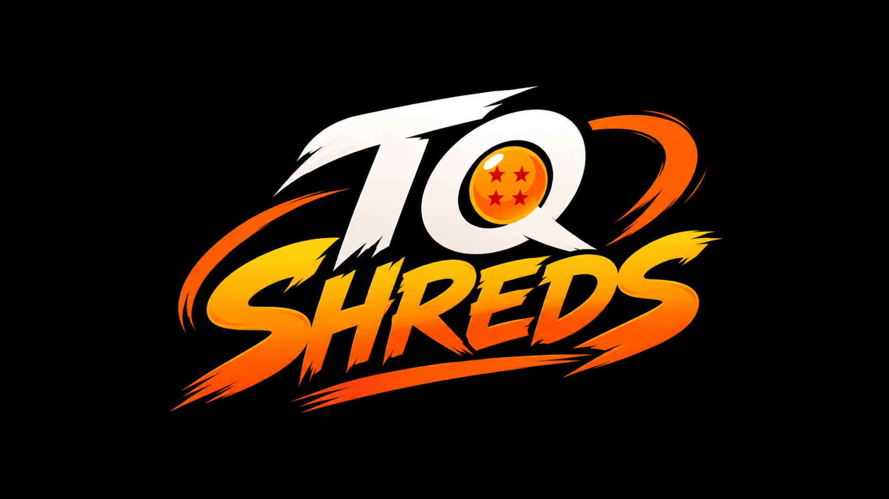

# TQ SHREDS

  

  <strong>Train. Eat. Track.</strong>

  A personal, offline-first fitness and nutrition journal built for Android.

---

## About

**TQ SHREDS** is a personal fitness and nutrition tracking app focused on keeping everything simple, fast, and local.

It is designed around one idea:

> **Train consistently. Eat intelligently. Track your progress.**

The app is being built as an **offline-first Android application**, with user data stored locally on the device rather than depending on accounts, cloud services, or a backend.

## Planned Features

- 🏋️ Workout and exercise tracking
- 📅 Calendar-based workout history
- 📊 Exercise progression and statistics
- 🍱 Food and nutrition tracking
- 🥩 Calories and macro tracking
- 💧 Water tracking
- ⚖️ Body-weight tracking
- 📈 Progress tracking
- 🏆 Personal records
- 💾 Local backup and restore
- 🤖 Optional local/offline intelligence for nutrition estimation

## Technology

- **React Native**
- **Expo**
- **TypeScript**
- **Expo Router**
- **SQLite**
- **React Native Reanimated**
- **Hermes**

## Philosophy

TQ SHREDS is intentionally being built without unnecessary infrastructure.

- **Local-first**
- **Offline-capable**
- **Fast**
- **Private**
- **Lightweight**
- **Simple to use**

The project prioritizes reliable core functionality and data integrity before the final visual/UI layer.

## Development Status

🚧 **Under active development**

The core architecture and functionality are being developed incrementally before the final UI and animation pass.

## Project

**TQ SHREDS**  
Personal Android fitness & nutrition journal.

---

  <strong>TRAIN • EAT • TRACK</strong>

